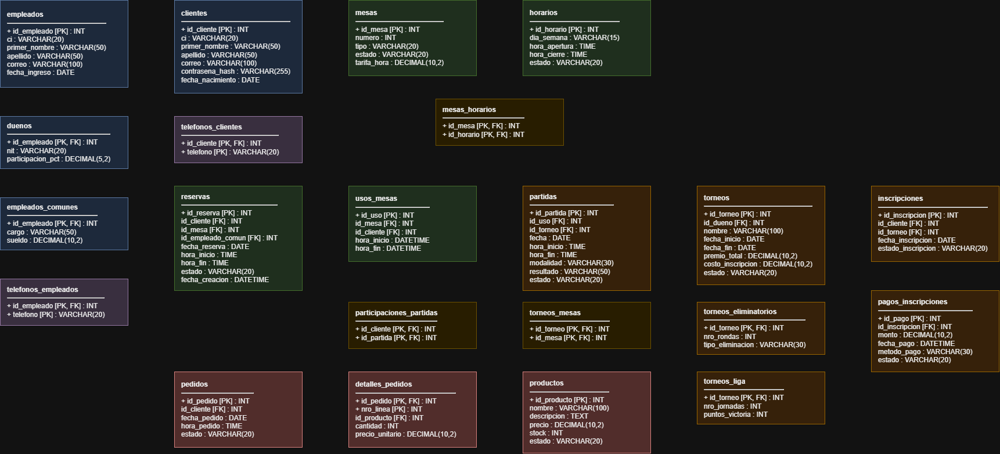

# Modelo de Datos — EL CLUB

## 1. Descripción General
La base de datos física del sistema (`elclubom`) sigue un modelo relacional normalizado diseñado para gestionar el personal del club de billar, sus roles jerárquicos, medios de contacto y las operaciones vinculadas a la administración del establecimiento.

- **Script DDL ejecutable:** [`database/script_elclub.sql`](../database/script_elclub.sql)
- **Archivo fuente del modelo:** [`docs/base-datos/10-09-MODELOLOGICOOFICIAL.txt`](base-datos/10-09-MODELOLOGICOOFICIAL.txt)

## 2. Diagrama Lógico / Entidad-Relación

## 3. Diccionario de Entidades Principales
- **`empleados`**: Tabla base con la información general del personal (identificador único, datos personales y estado).
- **`duenos`**: Especialización de empleados con privilegios administrativos y de supervisión del club.
- **`empleados_comunes`**: Especialización para el personal operativo encargado de la atención diaria y control de mesas.
- **`telefonos_empleados`**: Entidad multivaluada normalizada que almacena uno o varios números de contacto por cada empleado mediante clave foránea (`FK`).

## 4. Instrucciones de Ejecución de la Base de Datos
1. Abrir el gestor de base de datos relacional compatible con SQL (MySQL / MariaDB / SQL Server según entorno).
2. Abrir el archivo `database/script_elclub.sql`.
3. Ejecutar el script completo para crear la base de datos `elclubom`, sus tablas, claves primarias (`PK`), claves foráneas (`FK`) y restricciones de validación (`CHECK`).
